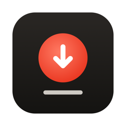
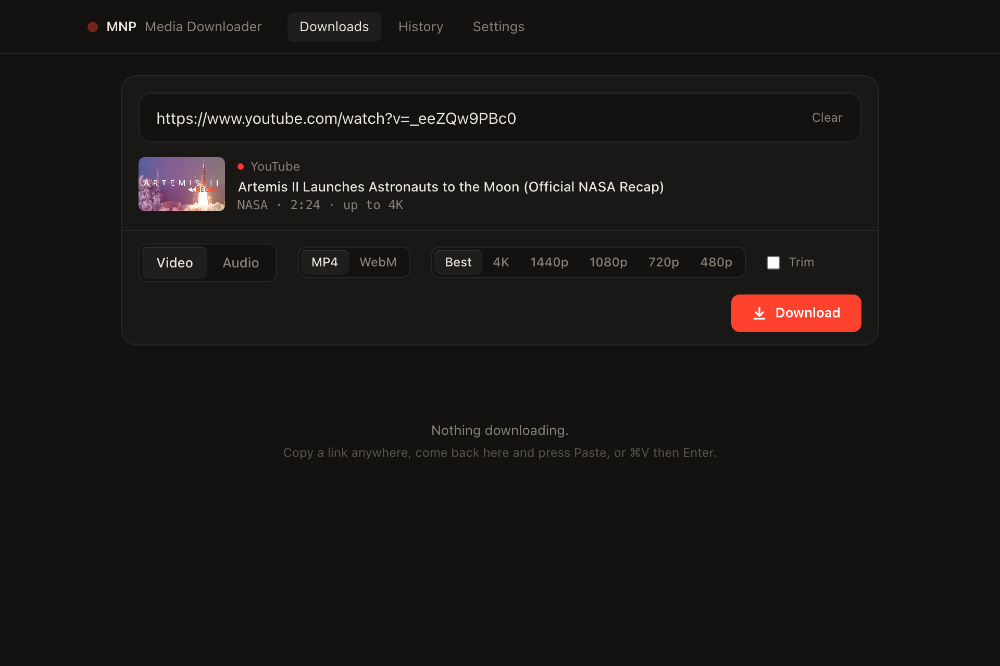
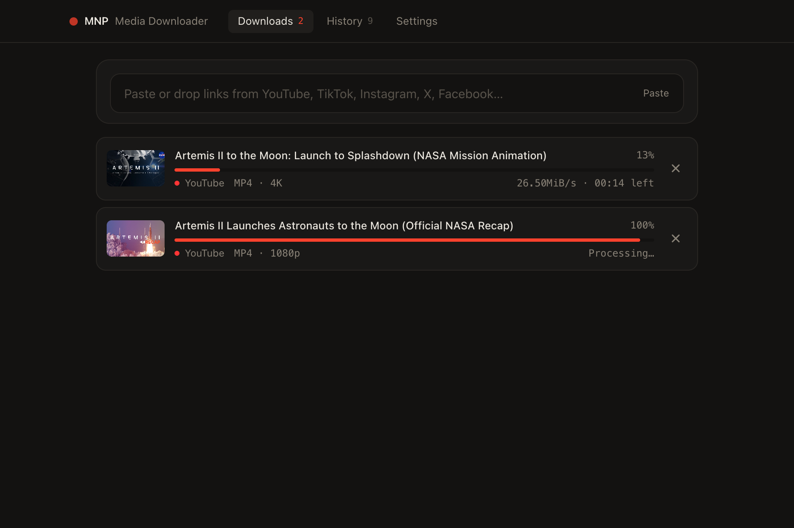
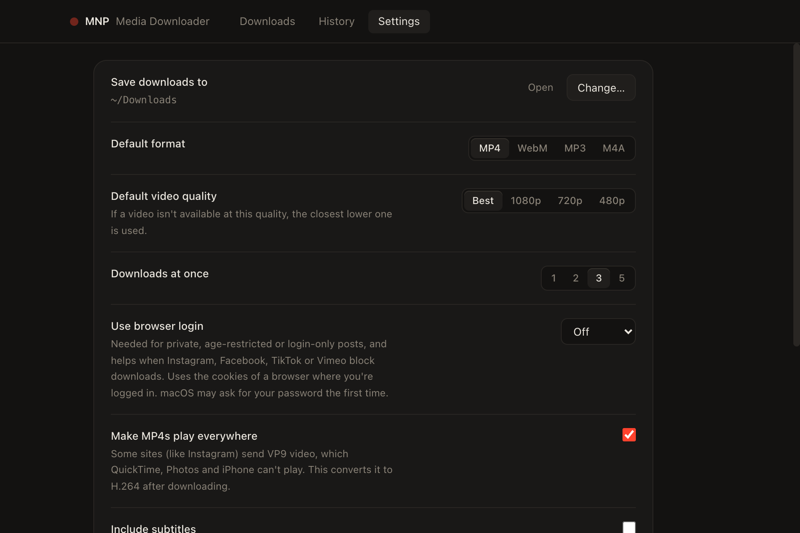

<p align="center">
  
</p>

<h1 align="center">MNP Media Downloader</h1>

<p align="center">
  A Mac app for saving videos and audio from YouTube, TikTok, Instagram, Facebook, X and more.<br>
  Paste a link, pick a format, done.
</p>

<p align="center">
  
</p>

## Features

- **Paste and go.** Paste or drag in a link and see the title, thumbnail, length and the qualities that are actually available before you download.
- **Video or audio.** MP4 or WebM up to 4K, or MP3 / M4A with cover art.
- **Plays everywhere.** Instagram and Facebook often send VP9 or AV1 video that QuickTime, Photos and iPhone can't open. The app converts these to H.264 automatically, using the Mac's hardware encoder.
- **Several at once.** Paste a whole list of links; downloads run side by side with live progress, speed and time left.
- **Playlists.** Download an entire YouTube playlist into its own numbered folder.
- **Trim.** Save just part of a video, for example 1:30 to 2:00.
- **Subtitles.** Optionally include the creator's subtitles inside the video.
- **Menu bar shortcut.** Copy a link anywhere, then choose *Download Copied Link* from the menu bar icon.
- **Notifications** when downloads finish in the background.
- **Stays working.** The download engine updates itself daily, because sites change often.
- **Clear errors.** Instead of raw error codes, the app says what went wrong and what to do about it.

<p align="center">
  
</p>

## Supported sites

| Site | Video | Audio | Notes |
| --- | :---: | :---: | --- |
| YouTube (videos, Shorts, playlists) | ✅ | ✅ | Up to 4K |
| TikTok | ✅ | ✅ | |
| Instagram (Reels, posts) | ✅ | ✅ | Private posts need *Use browser login* |
| Facebook (videos, Reels) | ✅ | ✅ | |
| X / Twitter | ✅ | ✅ | Only posts that contain a video |
| SoundCloud | | ✅ | |
| Vimeo | ✅ | ✅ | Needs *Use browser login* |

Hundreds of other sites work too, since the app is built on [yt-dlp](https://github.com/yt-dlp/yt-dlp).

**Not supported:** TikTok and Instagram *sound* pages. Paste a video that uses the sound and choose *Audio* instead.

## Requirements

- A Mac with Apple Silicon (M1 or newer)
- macOS 13 Ventura or newer

## Installing

1. Download the latest `.dmg` from the [Releases page](https://github.com/PaulMNP/mnp-media-downloader/releases/latest) and open it.
2. Drag **MNP Media Downloader** into **Applications**.
3. Open it from Applications or Spotlight.

The app is not signed with an Apple Developer ID, so macOS may refuse to open it the first time. If that happens, try opening it once, then go to **System Settings → Privacy & Security**, scroll down and click **Open Anyway**.

The first launch takes about 10 seconds longer while macOS checks the built-in download tools.

## Using it

1. Copy a link from your browser or phone.
2. In the app, click **Paste** (or press ⌘V), or drag the link onto the window.
3. Choose **Video** or **Audio**, a format and a quality, then click **Download**.

Finished downloads go to your Downloads folder (change this in Settings) and appear under **History**, where you can open them or show them in Finder.

<p align="center">
  
</p>

### Private or login-only posts

Turn on **Settings → Use browser login** and choose a browser where you're signed in to the site. The app then uses that browser's cookies for downloads. macOS may ask for your password the first time. Nothing is sent anywhere except to the site you're downloading from.

### If a site stops working

Sites change how they serve video all the time. Go to **Settings → Check for updates** to get the newest download engine. The app also does this automatically once a day.

## Building from source

You need [Node.js](https://nodejs.org) 20.19 or newer (or 22.12+).

```sh
npm install
npm run dev      # run the app in development mode
npm run dist     # build the .app and .dmg into dist/
```

Both commands first run `scripts/fetch-binaries.sh`, which downloads yt-dlp and a redistributable FFmpeg build into `resources/bin` (not committed to git).

## Responsible use

This app is meant for saving content you have the right to download, such as your own uploads, content with a permissive license, or content that is in the public domain. Respect the terms of service of each site and the rights of creators. You are responsible for how you use the app.

This project is not affiliated with, endorsed by or sponsored by YouTube, Google, TikTok, ByteDance, Instagram, Facebook, Meta, X, SoundCloud or Vimeo. All trademarks belong to their owners.

## License

Copyright © 2026 PaulMNP. All rights reserved. See [LICENSE](LICENSE).

The app bundles third-party software (yt-dlp, FFmpeg, Electron) under their own licenses. See [THIRD_PARTY_NOTICES.md](THIRD_PARTY_NOTICES.md).
